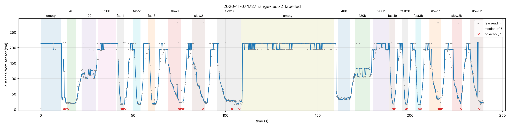

# 2026-11-07_1727_range-test-2_labelled

| Phase | Readings | Median (cm) | Spread p10–p90 (cm) | Outliers | No echo | Approach 140→40 cm |
|---|---|---|---|---|---|---|
| empty | 96 | 212.7 | 212.3–213.1 | 1 | 0 | – |
| 40 | 48 | 19.8 | 19.1–22.1 | 0 | 1 | – |
| 120 | 73 | 114.1 | 100.3–128.3 | 3 | 0 | – |
| 200 | 87 | 213.1 | 192.9–213.6 | 1 | 0 | – |
| fast1 | 36 | 95.2 | 16.2–213.7 | 2 | 8 | 1.04 m/s |
| fast2 | 37 | 27.0 | 16.2–193.4 | 1 | 0 | 1.16 m/s |
| fast3 | 37 | 31.1 | 16.5–212.0 | 0 | 0 | 1.34 m/s |
| slow1 | 65 | 71.9 | 23.6–135.0 | 6 | 4 | 0.22 m/s |
| slow2 | 65 | 75.8 | 26.1–151.5 | 4 | 1 | 0.24 m/s |
| slow3 | 122 | 28.5 | 17.8–107.8 | 3 | 3 | 0.33 m/s |
| empty | 438 | 213.6 | 193.8–214.0 | 0 | 0 | – |
| 40b | 62 | 33.6 | 31.7–37.7 | 0 | 0 | – |
| 120b | 77 | 129.9 | 104.7–132.9 | 3 | 0 | – |
| 200b | 76 | 212.0 | 192.0–213.5 | 0 | 0 | – |
| fast1b | 30 | 39.9 | 17.1–213.2 | 2 | 4 | 1.17 m/s |
| fast2b | 30 | 35.2 | 16.5–169.7 | 1 | 2 | 1.56 m/s |
| fast3b | 29 | 23.4 | 16.0–147.2 | 1 | 2 | 1.55 m/s |
| slow1b | 58 | 78.4 | 32.7–212.2 | 3 | 11 | 0.39 m/s |
| slow2b | 51 | 66.2 | 22.9–193.4 | 3 | 1 | 0.44 m/s |
| slow3b | 67 | 63.4 | 20.6–199.5 | 7 | 1 | 0.25 m/s |
