# Interaction sensors

How the dog perceives visitors. This is the **sense → interpret → respond** loop that the Physical Interfaces module is built around. Until now the dog only had outputs (servos); this file covers its inputs.

## Goal

The dog notices **how** someone approaches, slow or fast, near or far, and shows an emotional state through its body language:

```
relaxed  →  alert  →  afraid  →  frozen
   ↑______________________________|   (calms down slowly when the visitor stays slow and calm)
```

Later: a loud noise startles it, and gentle petting calms it.

## Plan, in order of impact per effort

| # | Input | Part from the kit | Why this order | Status |
|---|---|---|---|---|
| 1 | Distance and approach speed | Ultrasonic sensor HC-SR04 | Core of the artwork: how you approach a dog. Four wires, no extra parts, not disturbed by light or room noise | In progress |
| 2 | State machine | (software) | Maps distance and speed to relaxed / alert / afraid / frozen, with hysteresis and slow calming down | Planned |
| 3 | First reaction | Existing servos (ears, mouth, neck) | One end-to-end reaction: fast approach → mouth closes, head pulls back | Planned |
| 4 | Someone enters | PIR motion sensor HC-SR501 | Wide angle; wakes the dog when the ultrasonic cone cannot see yet | Nice-to-have |
| 5 | Loud noise | Sound sensor module | Startle on sudden loud sounds only. It cannot reliably tell quiet speech from silence | Nice-to-have, test first |
| 6 | Petting | Aluminium foil + 1 MΩ resistor | Capacitive touch, calms the dog | Planned |

### Known limits (to discuss in the portfolio)

- **Ultrasonic:** narrow cone (about 15–30°), so sideways approaches are seen late. Soft clothing absorbs sound and gives bad readings, so readings are filtered (median of several). Only the nearest object is measured.
- **Sound sensor:** cheap microphone with low gain. Detects claps and shouting, not "spoken to quietly". SG90 servos make noise, so the sound reading must be ignored while servos move, and the microphone mounted away from them.
- **Pacing:** a dog that twitches suddenly scares exactly the audience the artwork addresses. Reactions move slowly.

## Pins

Pins 3, 5, 6, 8, 9 and 10 are taken by servos; 2, 4 and 7 are reserved for the ears and the eyelid. The sensors use the analog header, whose pins also work as digital pins (A0 = 14, A1 = 15).

| Part | Pin | Wire colour |
|---|---|---|
| HC-SR04 VCC | Uno `5V` | red |
| HC-SR04 Trig | `A0` | white |
| HC-SR04 Echo | `A1` | purple |
| HC-SR04 GND | breadboard `−` strip (connected to Uno GND) | black |

The sensor takes its 5 V from the Uno, not from the `+` strip: it draws only about 15 mA, and keeping it off the servo supply keeps servo noise out of the measurement. Both supplies share ground through the `−` strip.

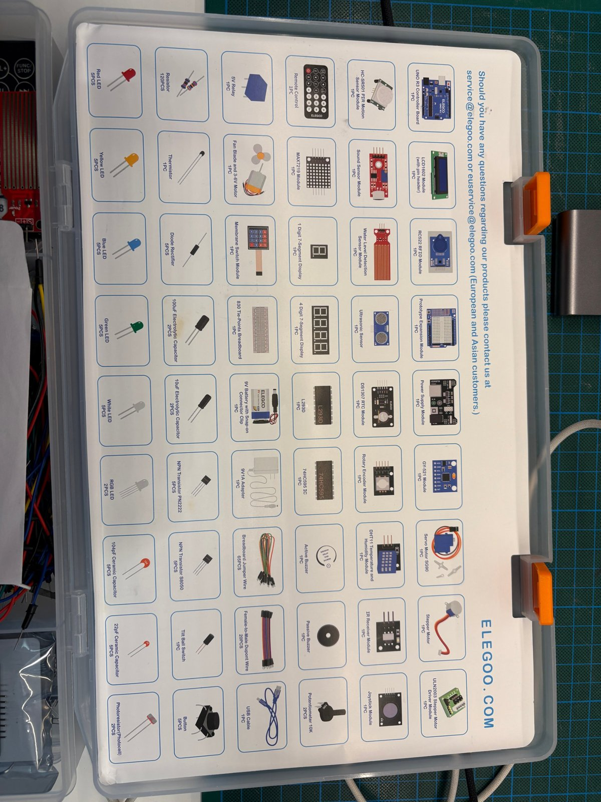

## Terminology

- **Ultrasonic sensor:** sends a burst of sound at 40 kHz, above human hearing (about 20 kHz), and listens for the echo.
- **Transmitter / receiver:** the two silver cylinders. One sends (T), one listens (R).
- **Time of flight (ToF):** the time between sending the pulse and receiving the echo. Distance = time × speed of sound ÷ 2 (the sound travels there and back).
- **Speed of sound:** about 343 m/s at 20 °C, which is 0.0343 cm per microsecond.
- **Trigger pulse:** a 10 µs HIGH signal on Trig that tells the sensor to measure once.
- **Echo pulse:** the sensor holds Echo HIGH for as long as the sound was travelling. The Uno measures that with `pulseIn()`.
- **VCC / GND:** supply voltage (5 V) and ground (0 V, the common reference all parts share).
- **Digital pin:** knows only two states, HIGH (5 V) or LOW (0 V). Reads with `digitalRead()`, writes with `digitalWrite()`.
- **Analog pin (A0–A5):** connected to the ADC (analog-to-digital converter), which turns a voltage between 0 and 5 V into a number from 0 to 1023 with `analogRead()`. Every analog pin can also be used as a normal digital pin.
- **`pulseIn()`:** waits for a pin to go HIGH and returns how many microseconds it stayed HIGH.
- **Timeout:** the longest `pulseIn()` waits before giving up and returning 0.
- **Common ground:** two power supplies must share GND, or signals between them have no reference.
- **Median filter:** take several readings and use the middle one, which throws away single bad readings.
- **Velocity:** change in distance ÷ change in time. Negative = coming closer.
- **Hysteresis:** different thresholds for entering and leaving a state, so the dog does not flicker between two states at a boundary.
- **State machine:** the dog is always in exactly one state; inputs decide when it switches to another.

## Build steps

### 1. Wiring

- **What:** HC-SR04 on the analog header: Trig `A0`, Echo `A1`, VCC to Uno `5V`, GND to the `−` strip.
- **Why:** all suitable digital pins are taken or reserved for the head servos.
- **How:** with the USB cable unplugged. Female ends onto the sensor, male ends into the Uno headers and the strip.

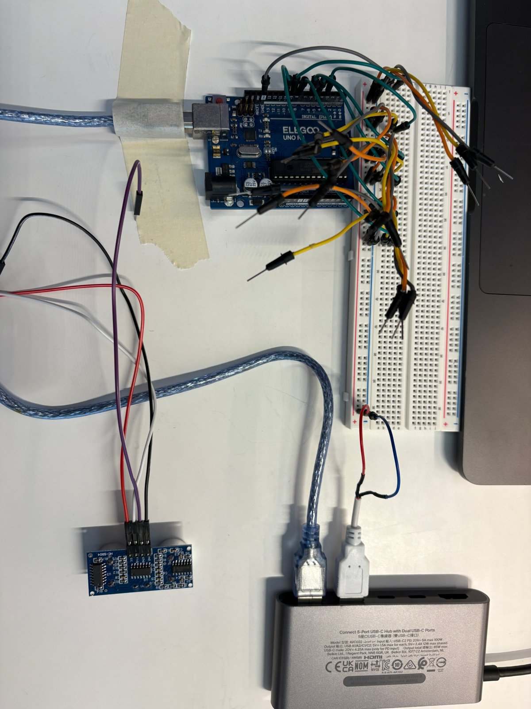

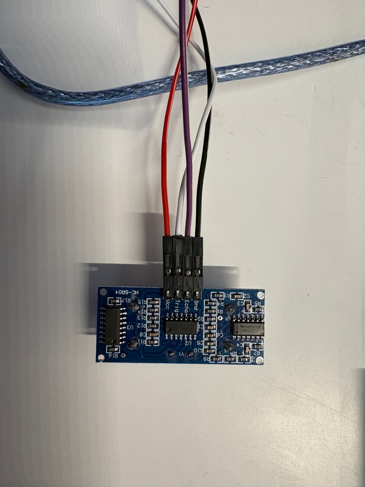

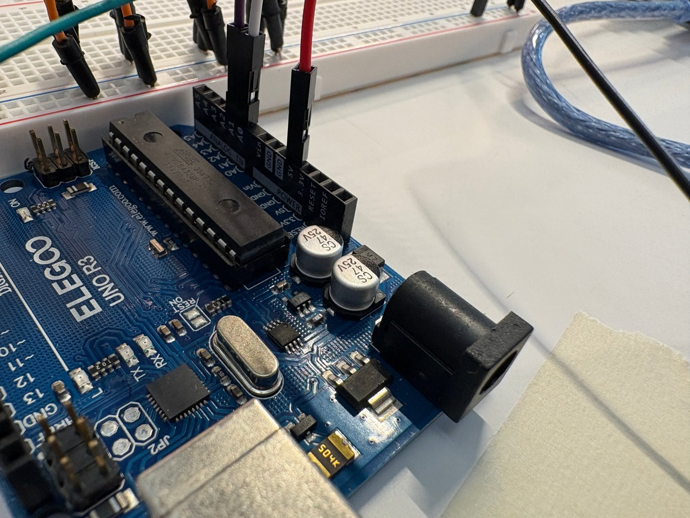

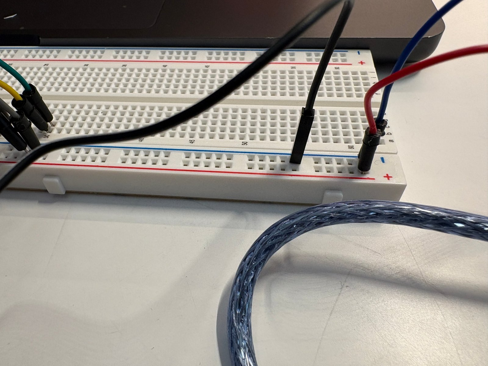

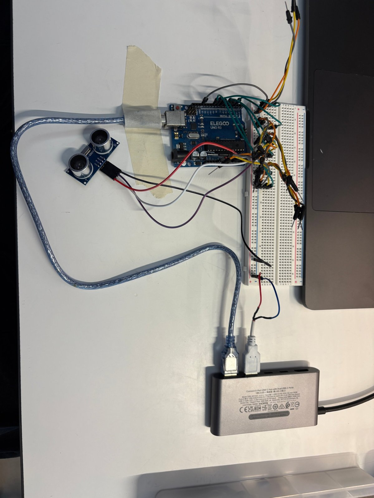

### 2. First sketch: distance in cm

- **What:** `tests/sensors/ultrasonic_distance` prints the distance about 10 times per second.
- **Why:** the sensor does nothing on its own. The Uno must trigger every measurement and time the echo. Seeing raw numbers first shows whether wiring and sensor work before any logic is built on top.
- **How:** 10 µs trigger pulse on Trig, `pulseIn()` on Echo with a 25 ms timeout, distance = duration × 0.0343 ÷ 2. `-1` means no echo.

- **Result:** works. Hand moving away: 1.7 → 22 cm. Hand held still at about 37 cm: readings between 34.9 and 41.9 cm, plus two outliers of about 241 cm.

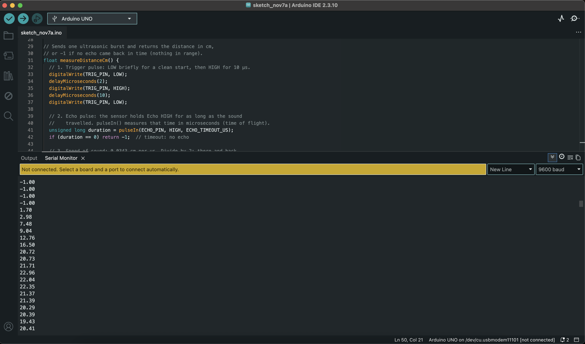

**What the numbers show:**

- `-1` at the start: no echo, nothing in range or too close.
- Below about 2 cm the readings are unreliable (the sensor's minimum range).
- **Noise / jitter:** ±1–2 cm even when the hand is still.
- **Outliers:** about 241 cm twice. The pulse missed the hand and the echo came from the wall behind it.
- **Consequence:** speed is computed from the change between readings. One outlier (37 → 241 → 37 cm in 0.2 s) would look like someone moving at 10 m/s. The readings must be filtered first (median of several) before speed means anything.

### 3. Range and speed test in the room

- **What:** sensor taped to pliers on the table edge, pointing horizontally into the room at table height. Folding rule on the floor with marks at 40, 120 and 200 cm. Stood ~6 s at each mark, then walked 200 → 40 twice fast and once slowly. About 750 readings over 75 s (16:57:49–16:59:04).
- **Why:** check the real range, the noise per distance and whether fast and slow approaches can be told apart, before writing any logic.

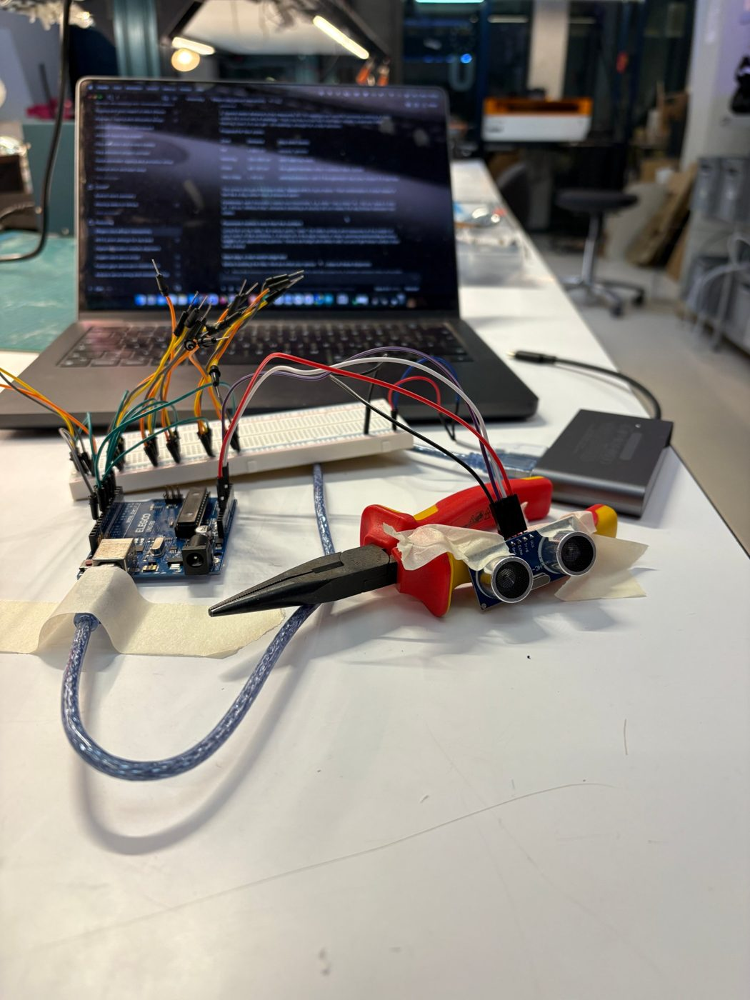

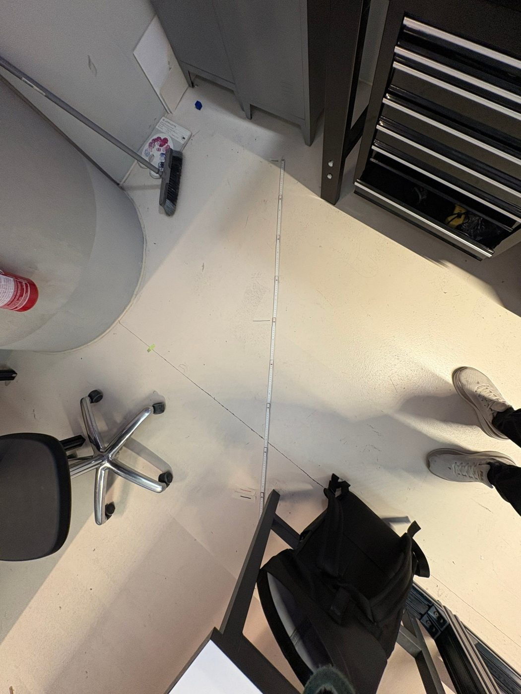

**Standing still:**

| Floor mark | Sensor reading | Spread | Notes |
|---|---|---|---|
| 40 cm | 17–24 cm | ±3 cm | occasional outliers (214, 161, 142, −1) |
| 120 cm | 87.5–91 cm | ±1.5 cm | most stable; one outlier (105) |
| 200 cm | jumps between ~163 and ~191 cm | bimodal | about 40 % of readings miss the person and hit the cabinet behind |

**Approaches (from ~163 cm to ~30 cm):**

| Run | Time | Average speed | Readings during the approach |
|---|---|---|---|
| Fast 1 | 1.2 s | ~1.2 m/s | ~12 |
| Fast 2 | 1.2 s | ~1.1 m/s | ~12 |
| Slow | ~9 s | ~0.15 m/s | ~90, with two pauses (at ~120 cm and ~65 cm, ~1.5 s each) |

**Findings:**

- **Offset:** readings are 20–37 cm lower than the floor marks. The rule's zero is not at the sensor face, and the sensor measures to the body, not the toes. Zones must be defined as distance from the sensor.
- **Reliable range:** up to ~90 cm very stable; at ~160 cm the person no longer fills the cone (at 160 cm a 30° cone is ~85 cm wide), so background objects win part of the time. Usable range in this setup: about 160 cm.
- **Fast vs. slow is easy to separate:** about 1.1 m/s vs. 0.15 m/s, a factor of ~8. Per reading, a fast approach moves 10–23 cm, a slow one 0–8 cm.
- **The slow approach had natural pauses.** That is what a careful approach to a real dog looks like, and the dog could reward it.
- **Outliers:** about 2 % of readings outside the 200 cm phase (single values of ~140–214 cm or −1). A median filter removes single outliers.

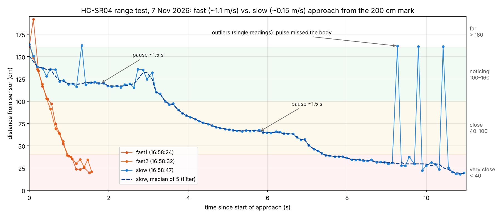

The approach readings are in [`data/sensor-logs/2026-11-07_range-test_approaches.csv`](../data/sensor-logs/2026-11-07_range-test_approaches.csv), transcribed from Serial Monitor screenshots. The dashed line shows what a median of 5 does: the single outliers at ~162 cm disappear, the pauses stay.

**Consequences for the logic:**

- Zones measured from the sensor: very close < 40 cm, close 40–100 cm, noticing 100–160 cm, far > 160 cm or no echo.
- Speed from median-filtered readings over ~0.5 s; first thresholds: slow < 0.3 m/s, fast > 0.6 m/s.
- Record the empty room once (baseline) to know which distances are furniture.

### 4. Range test 2 with the serial logger

- **What:** same setup and floor marks as test 3, logged with `tools/serial_log.py` instead of screenshots: 2,153 readings over 240 s. Two rounds of: empty room, 40 / 120 / 200 marks, 3× fast and 3× slow from 200 to 40.
- **Log:** raw file [`2026-11-07_1727_range-test-2.csv`](../data/sensor-logs/2026-11-07_1727_range-test-2.csv). The phase labels did not register during the test, so the phases were reconstructed from the readings afterwards in [`..._labelled.csv`](../data/sensor-logs/2026-11-07_1727_range-test-2_labelled.csv); the table is in [`..._labelled.md`](../data/sensor-logs/2026-11-07_1727_range-test-2_labelled.md).

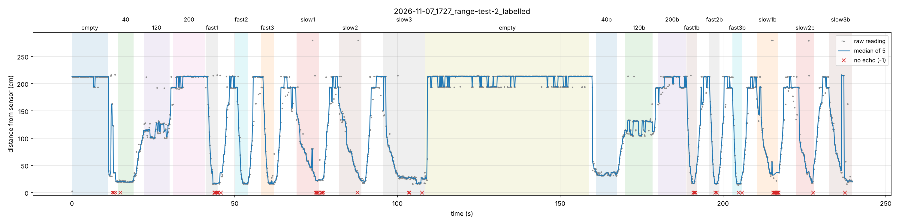

| Phase | Round 1 median (p10–p90) | Round 2 median (p10–p90) |
|---|---|---|
| Empty room | 212.7 cm (212.3–213.1) | 213.6 cm (193.8–214.0) |
| 40 mark | 19.8 cm (19.1–22.1) | 33.6 cm (31.7–37.7) |
| 120 mark | 114.1 cm (100.3–128.3) | 129.9 cm (104.7–132.9) |
| 200 mark | 213.1 cm (192.9–213.6), same as empty | 212.0 cm (192.0–213.5), same as empty |

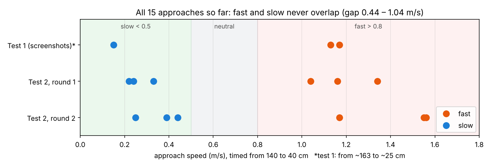

| | Round 1 | Round 2 |
|---|---|---|
| Fast (140 → 40 cm) | 1.04 / 1.16 / 1.34 m/s | 1.17 / 1.56 / 1.55 m/s |
| Slow (140 → 40 cm) | 0.22 / 0.24 / 0.33 m/s | 0.39 / 0.44 / 0.25 m/s |

**Findings:**

- **Fast and slow never overlap** across all 15 approaches (both tests): slow at most 0.44 m/s, fast at least 1.04 m/s. Speed is a reliable input.
- **Slow got faster in round 2** (up to 0.44 m/s). A tester who repeats a walk gets impatient; real visitors will vary even more. The thresholds therefore leave room: **slow < 0.5 m/s, neutral 0.5–0.8, fast > 0.8 m/s** (changed from 0.3 / 0.6).
- **Background:** the empty room returns 213 cm (wall) and sometimes 193 cm (cabinet). This baseline explains the ~191 cm readings in test 3.
- **At the 200 mark the person is invisible:** the readings equal the empty room. Usable range in this room is about **130–150 cm**, less than the 160 cm estimated in test 3.
- **Standing positions are not repeatable to the centimetre:** the same 40 mark gave 20 cm in round 1 and 34 cm in round 2, and the 120 mark jumps between ~101, ~115 and ~130 cm. Zones need margins and hysteresis.
- **New outlier type:** ~279 cm right next to the sensor (7 times), probably an echo bounced twice. Plus 48 no-echo readings (2 %), mostly below ~20 cm or while turning. The median filter handles both.

**Consequences:** "far" starts at 140 cm instead of 160 cm; speed thresholds 0.5 / 0.8 m/s; a reading equal to the empty-room baseline (±5 cm) counts as "nobody there".

## Repeating the test (protocol)

Use the logger instead of screenshots. It saves every reading with a timestamp and a phase label you type while testing.

**Once:** `pip3 install pyserial matplotlib` in Terminal.

**Setup:**

1. Sensor horizontal, at the height the dog's head will have, nothing within ~30 cm in front of it. Photo of the setup.
2. Marks on the floor measured **from the sensor face** (not from the table edge): 40, 100, 160, 220 cm. Photo of the marks.
3. Upload `tests/sensors/ultrasonic_distance`. Close the Serial Monitor and the browser bench (only one program can use the port).
4. In Terminal, in the repo folder: `python3 tools/serial_log.py range-test`

**Run** (type the label + Enter at the start of each phase; Enter alone while walking between marks):

| # | Label | What to do |
|---|---|---|
| 1 | `empty` | Nobody in front of the sensor, 10 s (baseline: what does the room itself return?) |

Check that the logger prints `========== PHASE: <label> ==========` after each label; if not, the label did not register. If typing while walking is impractical, leave the labels out and note the order instead: the phases can be reconstructed from the readings.

| 2 | `40` | Stand at the 40 mark, 6 s |
| 3 | `100` | Stand at the 100 mark, 6 s |
| 4 | `160` | Stand at the 160 mark, 6 s |
| 5 | `220` | Stand at the 220 mark, 6 s |
| 6 | `fast1`, `fast2`, `fast3` | From 220 to 40, fast. Enter alone on the way back |
| 7 | `slow1`, `slow2`, `slow3` | From 220 to 40, slowly |
| 8 | `side` | Approach from the side at 45°, normal speed |
| 9 | `q` | Stop. The CSV is in `data/sensor-logs/` |

Three runs per speed show how repeatable the speed is. Phases 1 and 8 cover what the first test left open: background objects and the narrow cone.

**Analyse:** `python3 tools/plot_log.py data/sensor-logs/<file>.csv` writes a plot (`.png`) and a table per phase (`.md`: readings, median, spread, outliers, approach speed from 140 to 40 cm) next to the CSV. Commit all three.

## Errors and solutions

- **"Nothing happens" after upload.** The black Output panel only shows compiler messages (memory use). Readings appear in the Serial Monitor: magnifying-glass icon at the top right, 9600 baud.
- **Only ~13 cm readings, never the person:** the sensor lay flat on the table and something close was in its cone. Fix: raise it and point it horizontally over the table edge with nothing in front.
- **Phase labels missing in the log** (test 4): nothing typed during the test registered except `q q` at 150 s, which became a label instead of stopping. Fix: the logger now prints a large `PHASE:` line as confirmation and also stops on `q q` / `quit`.
- **Only part of the log copied:** the Serial Monitor shows only what fits on screen. Clear it before a test and copy everything with the copy icon (two squares, top right).
- **"Not connected. Select a board and a port"** in the Serial Monitor: the IDE lost the USB port. Check the cable and pick the `usbmodem` port again under Tools → Port.
