# Setup guide: Uno, breadboard and first servo

A record of how the first servo (the jaw) was wired and tested, with the photos from the bench, including the mistakes on the way. Use it as the how-to for every servo after this one.

## 1. The servo plug

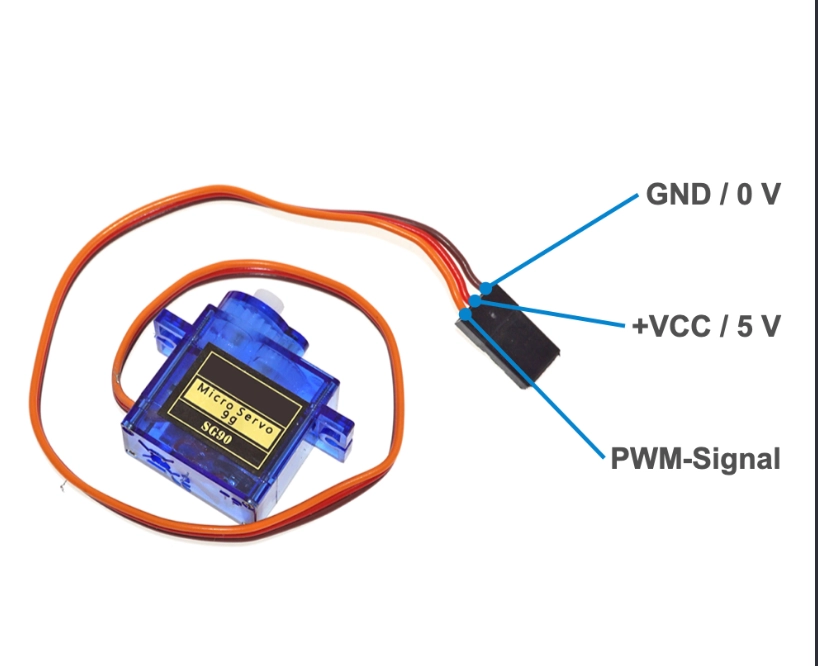

Every SG90 has the same three wires:

| Wire | Meaning | Goes to |
|---|---|---|
| Brown | GND / 0 V | the `−` strip on the breadboard |
| Red | +5 V | the `+` strip on the breadboard |
| Orange | signal | an Uno pin, through a breadboard row |

The plug is female, and so are the Uno's headers and the breadboard. Push male-to-male jumper wires into the plug to connect it. Swapping brown and red can destroy the servo, so check them before plugging in USB.

## 2. Uploading code with the Arduino IDE

The Arduino IDE works for editing and uploading sketches. `./flash.sh` does the same from a terminal.

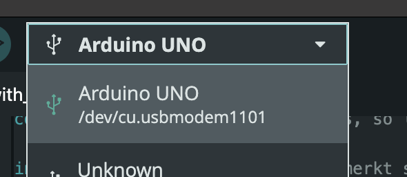

Before the first upload, choose the board and port in the dropdown next to the Upload arrow: **Arduino UNO** on **/dev/cu.usbmodem1101**.

Errors seen so far:

| Error | Cause | Fix |
|---|---|---|
| `Fehlender FQBN (Fully Qualified Board Name)` | No board selected | Pick Arduino UNO in the dropdown above |
| `cannot open port … Resource busy` | Another program has the USB port: the browser bench in Chrome, or the IDE's Serial Monitor | Close the bench tab or the Serial Monitor, then upload again |
| Sketch is much smaller than expected | The wrong sketch window was open | Check the tab name at the top of the editor |

Only one program can use the USB port at a time: the IDE upload, the IDE Serial Monitor, or the browser bench.

## 3. Which board from the kit

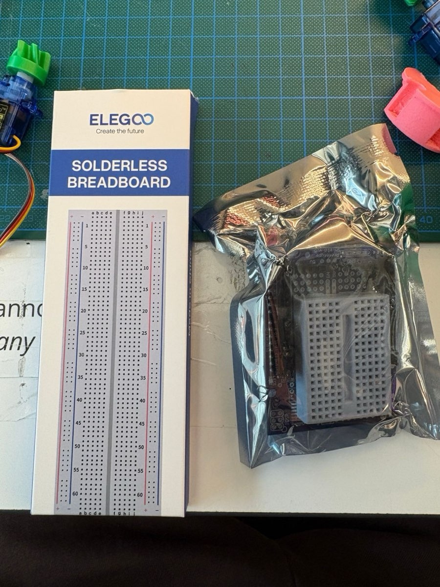

- **Big breadboard (the box):** used for wiring the servos. It has `+` and `−` strips along both long edges, and they run the full length without a break.
- **Prototype Shield v5 (the silver bag):** plugs on top of the Uno and has a mini breadboard, but no power strips. Not used for now.

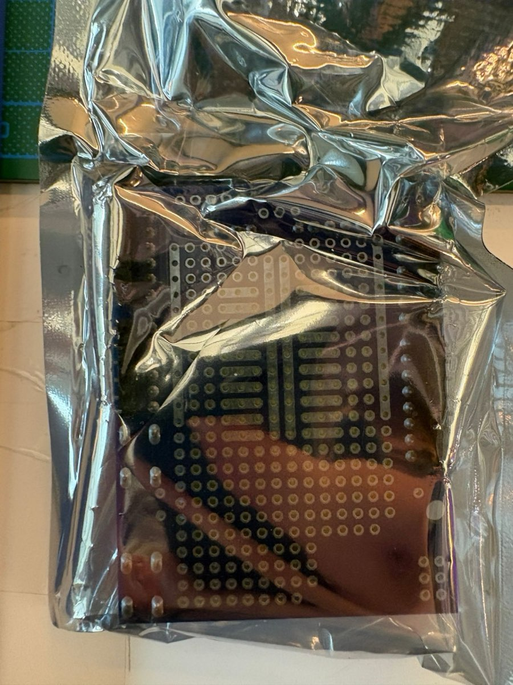

## 4. How the breadboard is connected inside

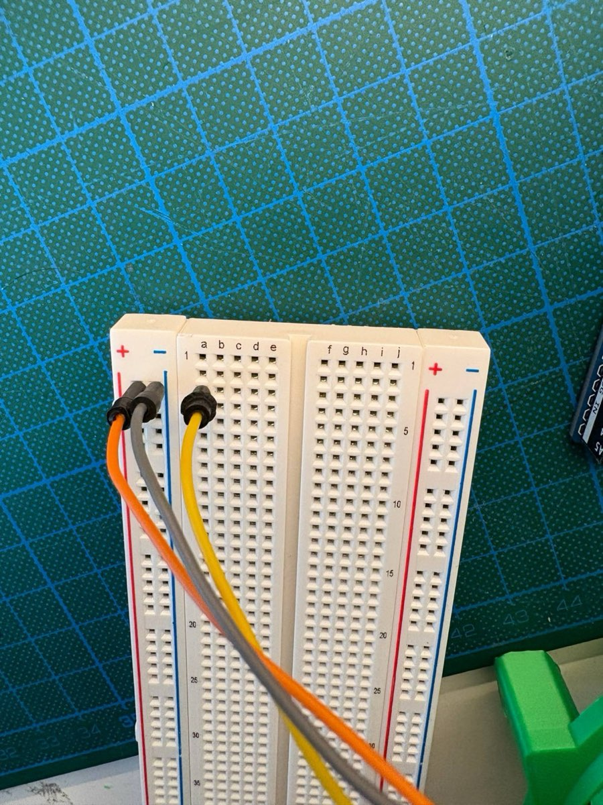

- **`+` and `−` strips (outer columns):** connected lengthwise, along the whole red or blue line. Feed 5V into one hole and every hole in that strip has 5V.
- **Middle area:** each numbered row is two groups of 5 connected holes, `a–e` and `f–j`. `a3` and `b3` are connected; `a3` and `a4` are not.
- The numbers 1–63 name the rows and the letters name the holes within a row.

## 5. Wiring the jaw servo

### The mistake: no power to the strips

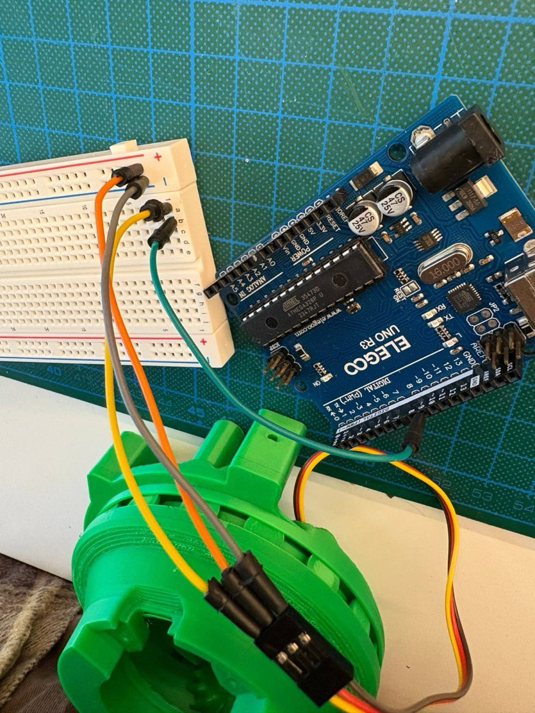

The servo's red and brown were in the `+` and `−` strips, and the signal reached pin 9 through row 1. But nothing connected the Uno's 5V and GND to the strips, so the servo got no power. **The strips only carry power once a wire from the Uno feeds them.**

### Working: Uno feeds the strips

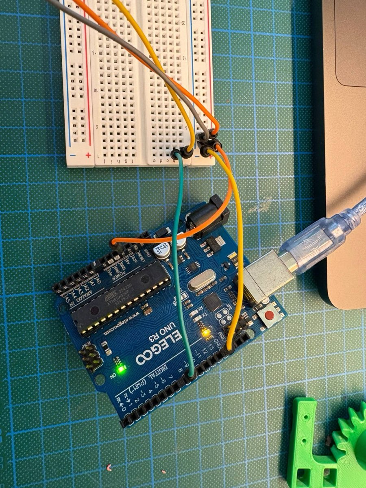

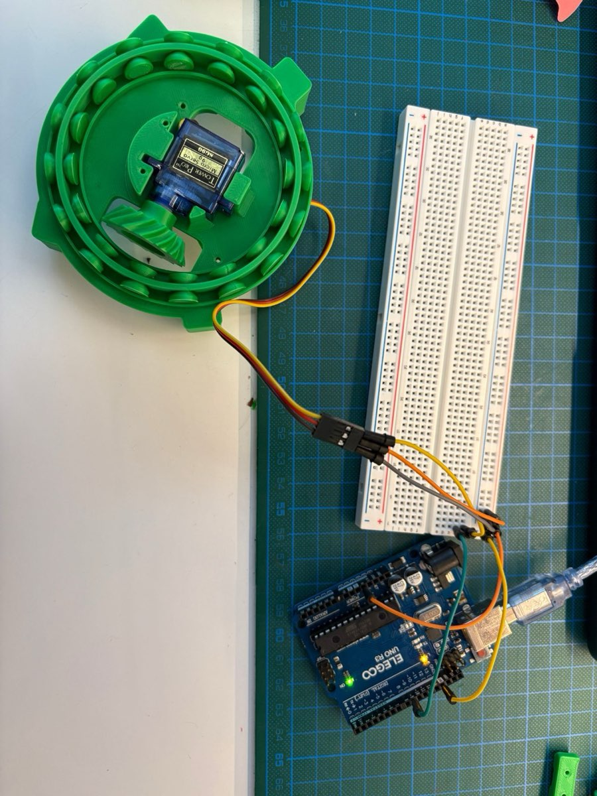

### Final wiring, with the colour convention

From here on: **red = 5V, grey = GND**, other colours for signals. Wire colour makes no difference to the electricity, but it keeps nine servos readable.

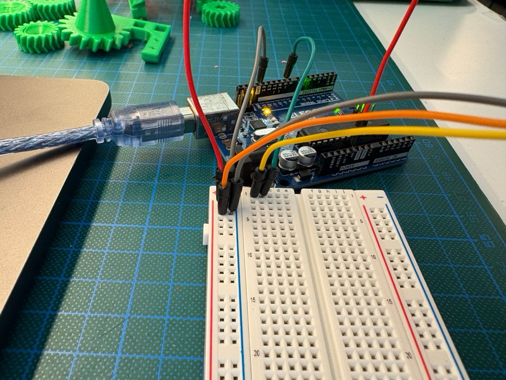

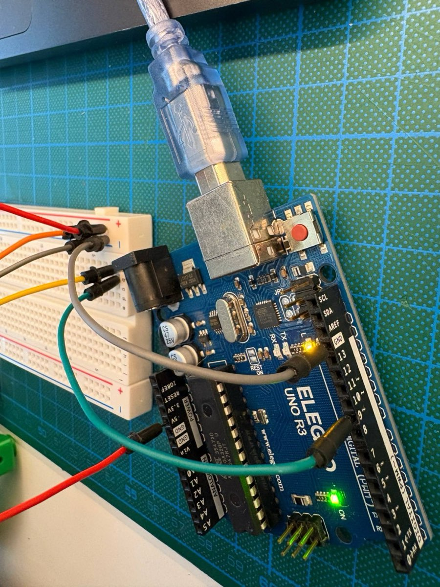

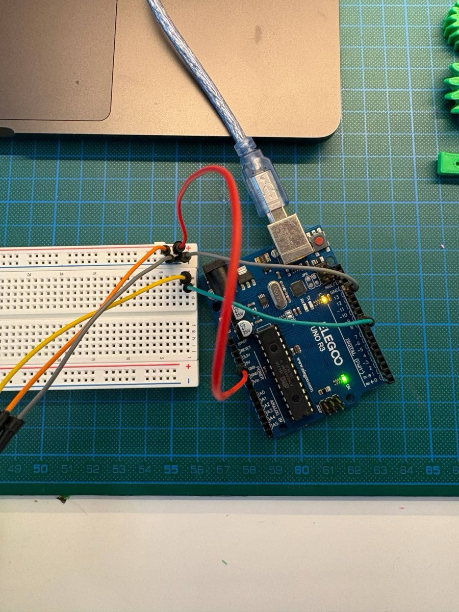

| From | Wire | To |
|---|---|---|
| Uno `5V` (POWER header) | red | `+` strip |
| Uno `GND` (top header, next to 13) | grey | `−` strip |
| Uno pin `~9` | green | `b1` |
| `a1` | yellow | servo orange (signal) |
| `+` strip | orange | servo red |
| `−` strip | grey | servo brown |

The same setup lives in [`bench/wiring.json`](../bench/wiring.json), and the browser bench draws it:

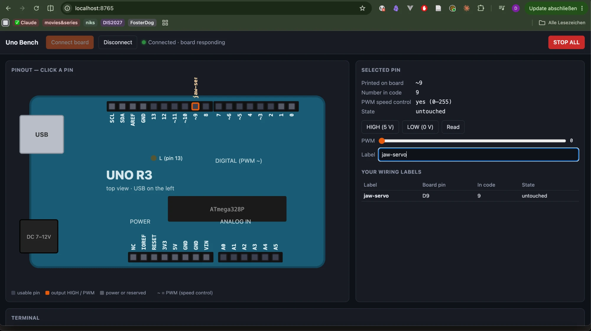

## 6. Adding the next servo

1. Unplug USB.
2. Pick a free row, leaving one empty row after the last part (the jaw uses row 1, so the next one goes in row 3 or later).
3. Servo brown into `−`, red into `+`, orange into hole `a` of that row.
4. A jumper from hole `b` of the same row to the Uno pin from the pin map (neck yaw: pin 2).
5. Check brown and red, then plug in USB.
6. In the bench, click the part in the Parts list, enter the row, untick "planned" and set the wire colours.
7. Test with the angle slider, then save the closed and open angles with the two "Save slider as …" buttons.

Two servos are about the limit for USB power. If the Uno restarts or the servos twitch, it is short on power: move one servo at a time and unplug the ones you are not testing.

## 7. Later: more than two servos

The long-term plan is a PCA9685 16-channel servo board with its own 5 V supply (at least 3 A for nine servos):

- Servo plugs slide straight onto its rows of male pins, like on Will Cogley's CogNog board, so no jumper wires are needed.
- The servos draw power from the external supply, not from the Uno.
- It connects to the Uno with only four wires (GND, 5V, SDA, SCL), which leaves the PWM pins free for the motor driver.
- It works the same with an ESP32, if the final robot moves to one.

The external supply's GND must always be connected to the Uno's GND.
