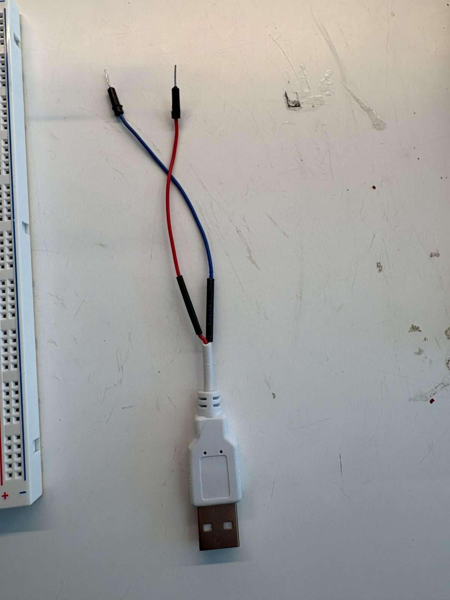
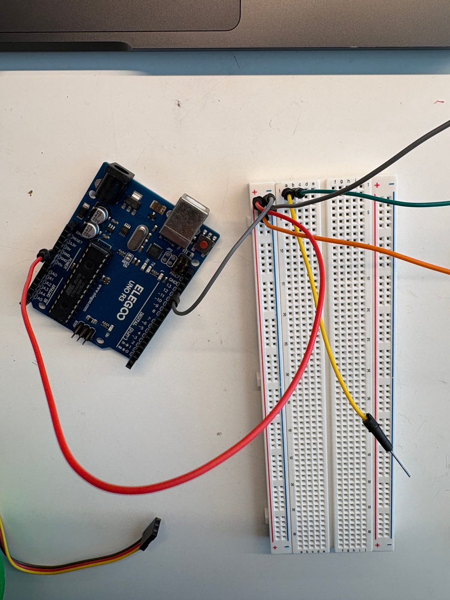
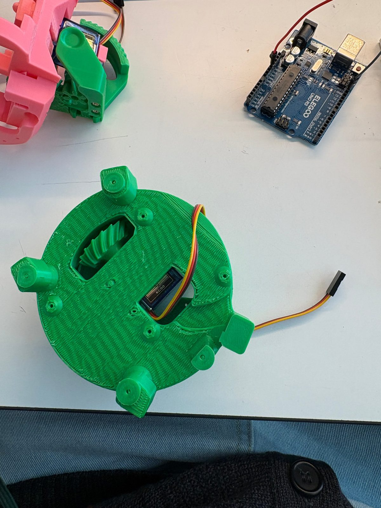
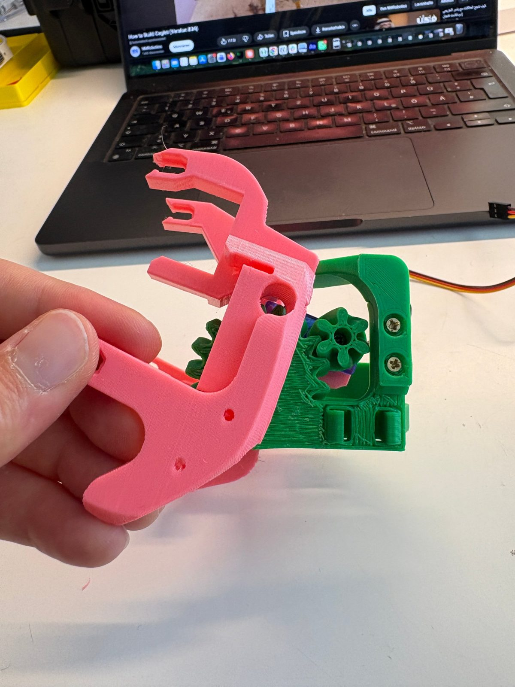

# Setup guide: Uno, breadboard and first servo

A record of how the first servo (the jaw) was wired and tested, with the photos from the bench, including the mistakes on the way. Use it as the how-to for every servo after this one.

## 1. The servo plug

Every SG90 has the same three wires:

| Wire | Meaning | Goes to |
|---|---|---|
| Brown | GND / 0 V | the `−` strip on the breadboard |
| Red | +5 V | the `+` strip on the breadboard |
| Orange | signal | an Uno pin, through a breadboard row |

The plug is female, and so are the Uno's headers and the breadboard. Push male-to-male jumper wires into the plug to connect it. Swapping brown and red can destroy the servo, so check them before plugging in USB.

## 2. Uploading code with the Arduino IDE

The Arduino IDE works for editing and uploading sketches. `./flash.sh` does the same from a terminal.

Before the first upload, choose the board and port in the dropdown next to the Upload arrow: **Arduino UNO** on **/dev/cu.usbmodem1101**.

Errors seen so far:

| Error | Cause | Fix |
|---|---|---|
| `Fehlender FQBN (Fully Qualified Board Name)` | No board selected | Pick Arduino UNO in the dropdown above |
| `cannot open port … Resource busy` | Another program has the USB port: the browser bench in Chrome, or the IDE's Serial Monitor | Close the bench tab or the Serial Monitor, then upload again |
| Sketch is much smaller than expected | The wrong sketch window was open | Check the tab name at the top of the editor |

Only one program can use the USB port at a time: the IDE upload, the IDE Serial Monitor, or the browser bench.

## 3. Which board from the kit

- **Big breadboard (the box):** used for wiring the servos. It has `+` and `−` strips along both long edges, and they run the full length without a break.
- **Prototype Shield v5 (the silver bag):** plugs on top of the Uno and has a mini breadboard, but no power strips. Not used for now.

## 4. How the breadboard is connected inside

- **`+` and `−` strips (outer columns):** connected lengthwise, along the whole red or blue line. Feed 5V into one hole and every hole in that strip has 5V.
- **Middle area:** each numbered row is two groups of 5 connected holes, `a–e` and `f–j`. `a3` and `b3` are connected; `a3` and `a4` are not.
- The numbers 1–63 name the rows and the letters name the holes within a row.

## 5. Wiring the jaw servo

### The mistake: no power to the strips

The servo's red and brown were in the `+` and `−` strips, and the signal reached pin 9 through row 1. But nothing connected the Uno's 5V and GND to the strips, so the servo got no power. **The strips only carry power once a wire from the Uno feeds them.**

### Working: Uno feeds the strips

### Final wiring, with the colour convention

From here on: **red = 5V, grey = GND**, other colours for signals. Wire colour makes no difference to the electricity, but it keeps nine servos readable.

| From | Wire | To |
|---|---|---|
| Uno `5V` (POWER header) | red | `+` strip |
| Uno `GND` (top header, next to 13) | grey | `−` strip |
| Uno pin `~9` | green | `b1` |
| `a1` | yellow | servo orange (signal) |
| `+` strip | orange | servo red |
| `−` strip | grey | servo brown |

The same setup lives in [`bench/wiring.json`](../bench/wiring.json), and the browser bench draws it:

## 6. Second servo: separate 5 V supply for the strips

Two servos are too much for the Uno's 5V pin. From the neck servo on, the `+` and `−` strips get their power from a USB cable with jumper ends, plugged into a USB charger. The Uno keeps its own USB connection to the Mac for code and serial.

Before the change, the Uno's 5V (red) still fed the `+` strip:

1. Unplug both USB cables.
2. **Pull the red wire from Uno `5V` to the `+` strip.** Only one supply may feed a strip. Two supplies on the same strip push current into each other.
3. USB cable **red into `+`**, **blue into `−`**. Red is always +5 V; on this cable blue is GND. With a multimeter you can check it: red against blue should read about +5 V.
4. **Keep the grey wire from Uno `GND` to the `−` strip.** It now connects the two grounds. Without it the servo signal has no reference and the servos jitter or do nothing.
5. Neck pitch servo (up and down) in row 9: brown into `−`, red into `+`, orange into `a9`. A jumper from `b9` to Uno pin `3`.
6. Check brown and red on both servos. Plug the Uno into the Mac first, then the power cable.

The power cable is called **Servo power (USB 5V)** here and in the bench. It can go into the same USB hub as the Uno's cable. That is fine for one or two micro servos. If the Uno disconnects or restarts when a servo moves, or macOS warns that a USB device needs too much power, plug the power cable into a phone charger (at least 1 A) instead.

| From | Wire | To |
|---|---|---|
| USB power cable | red | `+` strip |
| USB power cable | blue | `−` strip |
| Uno `GND` (top header, next to 13) | grey | `−` strip |
| Uno pin `~9` | green | `b1` (jaw) |
| Uno pin `3` | green | `b9` (neck pitch) |
| Uno `5V` | — | **not connected any more** |

The pitch servo tilts the head up and down, and the mechanism only allows about 10° each way:

Test it with `tests/neck/neck_nod`, which moves 1° every 50 ms and at most `RANGE` degrees from the center. In the bench, click Pitch in the Parts list, untick "planned" and enter row 9. **Set its closed and open angles before pressing those buttons**: the default closed angle of 0 is far outside the neck's range. In the Serial Monitor at 115200 baud, always add a speed: `SERVO 3 100 50`, not `SERVO 3 100`.

The `+` and `−` strips are connected along their whole length, so it does not matter which hole of a strip a servo's red or brown wire uses. The bench draws them one row below the servo's row only so the wires do not overlap.

If the servos twitch or do nothing: is the charger plugged in, is the grey GND wire still there, and is the signal in the same row as the jumper to the Uno?

## 7. Adding further servos

1. Unplug both USB cables.
2. Pick a free row, leaving one empty row after the last part.
3. Servo brown into `−`, red into `+`, orange into hole `a` of that row.
4. A jumper from hole `b` of the same row to the Uno pin from the pin map.
5. Check brown and red, then plug in the Uno and the power cable.
6. In the bench, click the part in the Parts list, enter the row, untick "planned" and set the wire colours.
7. Test with the angle slider, then save the closed and open angles with the two "Save slider as …" buttons.

A phone charger is enough for two or three micro servos moving one at a time. For more, see the next section.

## 8. Later: more than three servos

The long-term plan is a PCA9685 16-channel servo board with its own 5 V supply (at least 3 A for nine servos):

- Servo plugs slide straight onto its rows of male pins, like on Will Cogley's CogNog board, so no jumper wires are needed.
- The servos draw power from the external supply, not from the Uno.
- It connects to the Uno with only four wires (GND, 5V, SDA, SCL), which leaves the PWM pins free for the motor driver.
- It works the same with an ESP32, if the final robot moves to one.

The external supply's GND must always be connected to the Uno's GND.
